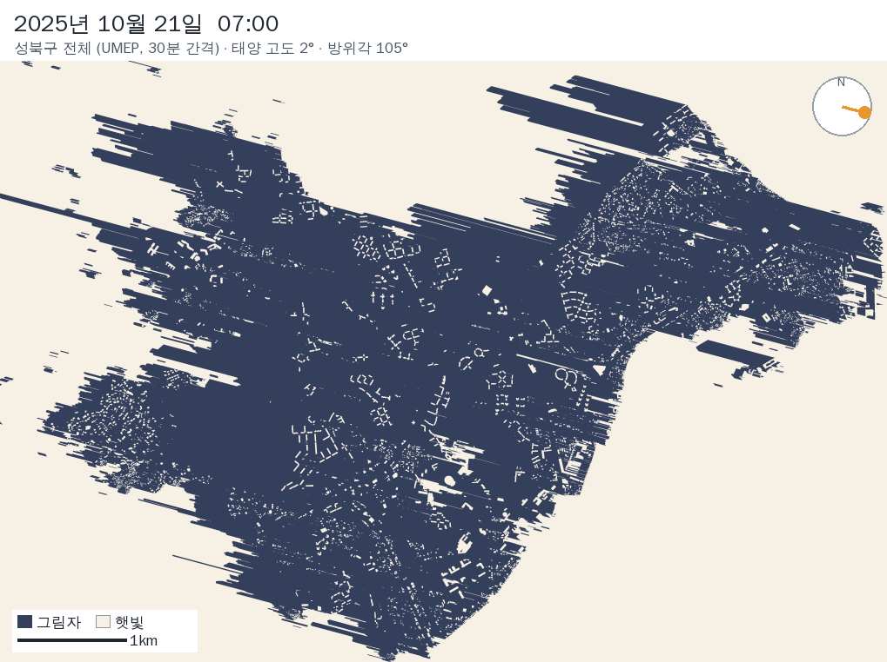
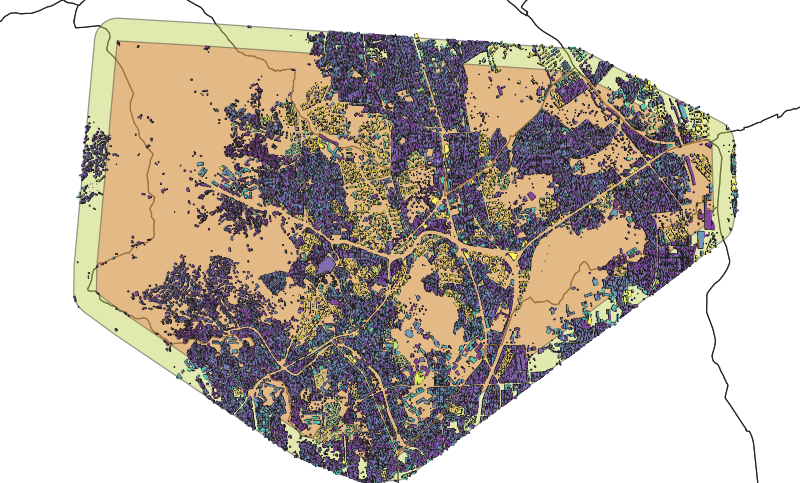
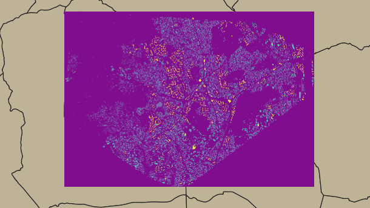
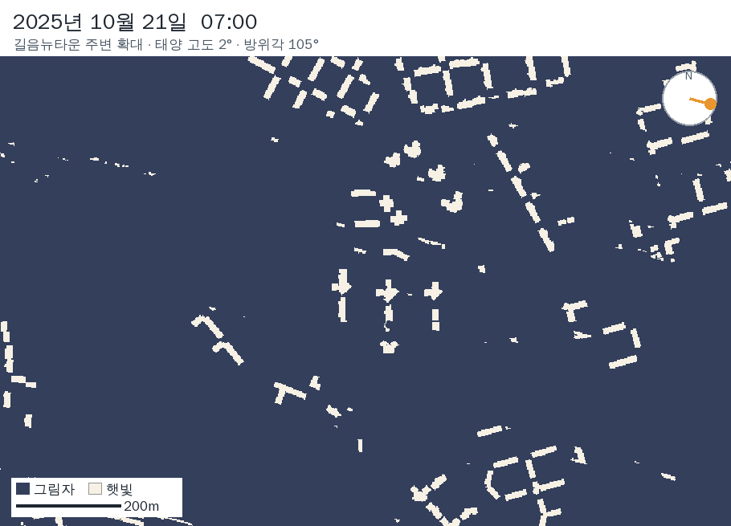

# 식집사: 우리 집 베란다 일조환경 추정과 식물 재배시기 추천

> 건축 공간정보와 기상 시계열 데이터를 활용한 주거공간 일조환경 추정 및 베란다 작물 재배시기 추천 시스템
> 빅데이터 캡스톤디자인 5조 · 2026년 2학기 (2026-09 ~ 2026-12)

같은 동네라도 몇 층인지, 창이 어느 쪽을 보는지, 앞에 어떤 건물이 서 있는지에 따라 베란다에 드는 햇빛은 크게 달라집니다. 식집사는 **주소, 동, 층, 창 방향**만 넣으면 그 창에 드는 직사광 시간과 실내 밝기를 달마다 계산하고, 기상청 기온 자료와 식물 생육조건을 비교해 **이번 달 키우기 좋은 식물 Top 3와 재배 시작 시기**를 추천합니다. 추천 이유와 키우는 방법은 농사로 등 공공 자료로 만든 식물 카드(RAG)에서 근거를 찾아 설명합니다.



---

## 한눈에 보기

| 단계 | 한 일 | 핵심 결과 |
| --- | --- | --- |
| 1. 기획 | 서비스 범위, 데이터, 시나리오 3세대(A·B·C) 정의 | 성북구 한정, 상대적 재배 적합도 추천 |
| 2. 건물 높이지도(DSM) | 서울 GIS건물통합정보 + 도로명주소 전자지도로 2m 격자 DSM 제작 | 성북구 + 300m 버퍼 건물 69,714동, 신축 단지 106곳 보강 |
| 3. 그림자·창별 직사광 | UMEP 그림자 지도, 태양 위치 + DSM 광선 추적으로 창별 10분 간격 직사광 계산 | 매달 21일 기준 월별 직사광 시간(direct_h) |
| 4. 실내 조도 | 일사량을 직달·확산으로 나누고 주변 건물 차폐, 유리 투과율 반영 | 창가 / 1m / 2m / 3m 위치별 lux, DLI |
| 5. 통합 추천엔진 | 일조·온도 적합도 중 낮은 값을 점수로 쓰는 제한요인 방식 + 실내식물 조도 점수 | A·B·C × 12개월 × 30종 = 1,080행, 규칙 점검 5개 통과 |
| 6. 평가 설계 | 실측·사람 평가가 어려워 계산 검증 + AI 심사위원(LLM-as-a-Judge) 루브릭 | 6개 항목 루브릭, 치명적 오류 상한 규칙 |
| 7. 앱 패키지 | QGIS 없이 서버에서 계산하는 FastAPI(Hugging Face Spaces용) | 주소 → 직사광·조도·Top3 JSON, A·B·C 결과 완전 일치 |
| 8. RAG 식물 DB | 농사로·농업기술길잡이·해외 공공자료로 식물 카드 244장, 벡터 DB | 2,209개 청크, bge-m3 임베딩, Chroma |

---

## 1. 기획

- **문제**: 베란다 텃밭이나 실내식물을 키우려 해도 우리 집 창에 햇빛이 얼마나 드는지 알기 어렵고, 일반적인 파종 달력은 층수·방향·주변 건물을 고려하지 않습니다.
- **목표**: 정밀한 일사량 측정이 아니라, 세대별 일조환경에 따른 **상대적인 재배 적합도**를 알려 주는 것.
- **범위**: 서울 성북구, 2025-10 ~ 2026-09 기상 자료, 식물 30종(채소 6, 열매채소 4, 허브 10, 실내식물 10).
- **기상 자료**: 성북구에는 ASOS 지점이 없어 서울(108, 종로구 송월동) 시간별 기온·일사량을 대표값으로 사용했습니다.
- **시나리오**: 조건이 다른 세 세대를 기준으로 계산하고 검증했습니다.

| 시나리오 | 위치 | 층·방향 | 특징 |
| --- | --- | --- | --- |
| A | 장위동 꿈의숲아이파크 709동 | 18층 남동향 | 고층, 앞이 트임 |
| B | 돈암동 돈암풍림 103동 | 4층 남향 | 저층, 앞 건물에 가림 |
| C | 길음뉴타운8단지 래미안 805동 | 1층 남향 | 1층, 단지 안쪽 |

관련 문서: [AI·에듀테크 활용 계획](docs/planning/AI-Edutech_활동계획.md), [앱 기획](docs/planning/식집사_앱기획.html)

## 2. 건물 높이지도(DSM)



- 국토교통부 GIS건물통합정보(서울)에서 건물을 뽑아 높이를 정했습니다. 높이 값이 있으면 그대로, 없으면 지상층수 × 3m, 둘 다 없으면 3m로 잡았습니다. 성북구 안에서는 각각 33.9%, 41.3%, 24.8%였습니다.
- 경계 바로 밖 건물도 그림자를 드리우기 때문에 **성북구 경계 + 300m 버퍼**까지 넣어 2m 격자 DSM을 만들었습니다(EPSG:5186).
- 서울 건물 파일에는 재개발 신축 단지가 빠져 있고, 허문 옛 주택이 남아 있었습니다. 그래서 **도로명주소 전자지도**와 비교해 빠진 건물 4,465동(신축 단지 106곳)을 채우고 옛 건물 칸을 지웠습니다. 이후로는 어떤 주소가 들어와도 도로명주소와 동 번호로 세대를 찾을 수 있습니다.



코드: [`src/building/dsm_buf300`](src/building/dsm_buf300), [`src/building/window_sun/make_dsm_juso.py`](src/building/window_sun/make_dsm_juso.py)

## 3. 그림자 지도와 창별 직사광

- QGIS UMEP Shadow Generator로 2025-10-21 07:00~17:30 30분 간격 그림자 지도 22장을 만들고, 3D 건물 위에 시간 순서대로 보여 주는 뷰를 만들었습니다.
- 창별 직사광은 Python으로 직접 계산했습니다. 태양 위치(NOAA 식)를 구하고, 해가 창 정면 ±90° 안에 있는지 본 뒤, 창 높이(층 × 3m)에서 태양 쪽으로 DSM을 따라가며 건물에 막히는지 판정합니다. 매달 21일을 10분 간격으로 계산해 **월별 직사광 시간(direct_h)** 을 얻습니다.
- **검증**: 태양 위치는 pvlib SPA와 비교해 고도 오차 0.016°, 방위각 오차 0.028° 이하였고, 가림 판정은 해석해(벽 한 개)와 같았으며 UMEP 방식 그림자와 99.8% 일치했습니다.



| 시나리오 | 연평균 direct_h | 월별 범위 |
| --- | --- | --- |
| A (18층 남동) | 7.0시간 | 5.3 ~ 7.7시간 |
| B (4층 남) | 3.3시간 | 1.0 ~ 5.3시간 |
| C (1층 남) | 2.7시간 | 0.5 ~ 4.8시간 |

코드: [`src/building/window_sun`](src/building/window_sun), [`src/building/shadow_3d`](src/building/shadow_3d)

## 4. 실내 조도(lux)

실내식물은 직사광 시간보다 실내 밝기가 중요해서, 창에서 떨어진 위치별 조도를 추정했습니다.

- ASOS 시간별 일사량을 직달광과 확산광으로 나누고(Erbs), 직달광은 위에서 계산한 10분 판정이 "햇빛 들어옴"일 때만 넣었습니다.
- 확산광은 방위별 주변 건물 스카이라인으로 가려지는 하늘을 빼고, 유리 투과율(0.70)과 실내 반사를 반영해 **창가 / 1m / 2m / 3m** 조도와 DLI를 계산했습니다.
- 결과(창에서 1m): A 4,060 ~ 10,772 lx, B 734 ~ 2,819 lx, C 1,124 ~ 6,553 lx. 직사광은 B가 C보다 많지만, B는 앞 건물이 하늘을 더 많이 가려(평균 차폐각 B 54°, C 47.6°) 실내 조도는 C가 더 높게 나왔습니다.

코드: [`src/indoor_lux`](src/indoor_lux), 결과: [`data/results/final_ABC_20261108`](data/results/final_ABC_20261108)

## 5. 통합 추천엔진

FAO 농업생태구역(AEZ)의 **제한요인 원리**를 참고해, 가장 부족한 조건이 점수를 정하도록 설계했습니다.

```
S_sun   = min(direct_h / 최소 일조시간, 1) × 100               (베란다 작물)
S_light = min(실내 조도 / 최소 요구 조도, 1) × 100              (실내식물)
S_temp  = 21일 매시 기온 24개를 사다리꼴로 점수화한 평균 × 100
          (적정 범위 안이면 1, 범위 밖 5℃까지 직선으로 줄어 0)
계절    = 파종·생육 시기가 아니면 제외
S_final = min(S_sun 또는 S_light, S_temp)
Top 3   = 제철이고 S_final ≥ 50(보통 이상)인 식물만, 베란다 작물 / 실내식물 따로
```

- 처음에는 가중합(일조 0.50, 온도 0.35, 계절 0.15)이었지만, 겨울에도 계절 점수만으로 50점이 나오는 문제가 있어 제한요인 방식으로 바꿨습니다.
- 온도 점수는 처음에 "범위 안 시간의 비율"이었는데, 밤 기온 때문에 너무 엄격해 농사로 재배 달력과 맞지 않았습니다. 사다리꼴 점수로 바꾸고, 50점 미만은 추천하지 않도록 했습니다.
- 식물 생육조건 값(plant_data.csv)은 모두 농사로 자료에서 가져왔고 임의로 바꾸지 않았습니다.
- **검증**(실측 없이 계산값과 공개 기준만 사용, `validate.py`): V1 규칙 점검(점수 범위, min 규칙, 계절 필터, 직사광 단조성, 조도 입력 일관성) 5개를 모두 통과했습니다. 그 밖에 21일 하루 기온의 대표성(V2), 일조 ±10·30분과 온도 ±1℃ 민감도(V3·V4), 1위 동점 수(V5)를 확인했습니다.
- 재배 달력 대조(V6)에서 파종·정식 적기 달에 엔진이 보통 이상을 준 비율은 A 41%, B 39%, C 38%였습니다. 이 달력은 초안이라 한계로 함께 적었습니다.

코드: [`src/suitability`](src/suitability)

## 6. 평가 설계

현장 측정이나 실제 사용자 평가를 할 수 없는 조건이라, 계산 검증과 **AI 심사위원(LLM-as-a-Judge)** 으로 평가를 설계했습니다.

- 초보자, 직장인, 텃밭 경험자, 원예 전문가 페르소나의 AI 심사위원이 추천 결과를 채점합니다.
- 루브릭 6개 항목: 추천 적합성, 근거 정확성, 이유 타당성, 재배법 충실성, 이해 용이성, 신뢰·실천 의향(1~5점).
- 엔진 결과를 바꾸거나 수치를 지어내는 등 치명적 오류(E1~E5)가 있으면 점수 상한을 둡니다.
- LLM 설명은 **RCCF(Role·Context·Command·Format) 프롬프트**로 엔진이 낸 순위와 점수는 바꾸지 않고, 이유와 재배법만 주어진 자료 안에서 설명하도록 했습니다.

문서: [`docs/evaluation`](docs/evaluation), [`docs/llm/RCCF_설명프롬프트.md`](docs/llm/RCCF_설명프롬프트.md)

## 7. 앱 패키지 (FastAPI · Hugging Face Spaces)

QGIS가 있는 노트북 한 대에서만 돌던 계산을 누구나 쓸 수 있게 서버용으로 옮겼습니다.

```
React 앱 ── GET /api/recommend?addr=..&dong=..&floor=..&facing=.. ──▶ app.py (FastAPI)
   engine/recommend.py
     ├─ analyze.py          sun_engine(직사광) + indoor_lux(실내 조도)   ← DSM(npy), 건물표
     └─ plant_suitability   통합 추천엔진 score() 그대로 사용            ← plant_data, ASOS
React 앱 ◀── JSON (월별 일조·조도 + 베란다 작물 / 실내식물 Top 3)
```

- numpy만으로 태양 위치와 가림 판정을 다시 구현해 QGIS 없이 계산합니다.
- `tests/check_ABC.py`로 최종 A·B·C 결과를 넣었을 때 원래 스크립트와 1,080행, Top 3가 모두 같은지 확인했습니다.

코드: [`app`](app) (실행 방법은 [`app/안내_앱_실행패키지.md`](app/안내_앱_실행패키지.md))

## 8. RAG 식물 DB

교수님 피드백을 반영해 "엔진이 순위를 정하고, LLM은 출처가 있는 자료로 설명한다"는 RAG 구조를 적용했습니다.

| 묶음 | 카드 수 | 출처 |
| --- | --- | --- |
| 추천 대상 30종 | 30 | 농업기술길잡이, 농사로 옥상허브정원, 농사로 실내정원용 식물 API, 해외 대학 원예자료(바질 등) |
| 그외 과일·꽃 | 7 | 농업기술길잡이(블루베리, 포도, 무화과, 국화, 장미, 감귤), Perenual(금귤, 레몬) |
| 그외 실내식물 | 207 | 농사로 실내정원용 식물 API 전체 |

- 카드는 같은 양식(빛, 온도, 씨뿌리기, 물, 흙, 병해충, 수확, 베란다 팁, 엔진 기준값)으로 정리하고, 실내정원 API 카드는 스크립트로 자동 생성했습니다.
- 자료를 구할 수 없는 식물은 넣지 않는 것을 원칙으로 했습니다(예: 수국은 제외).
- 섹션 단위로 2,209개 청크를 만들고 bge-m3 임베딩 + Chroma(코사인)로 벡터 DB를 구성했습니다. 질문에 식물 이름이 있으면 그 식물로 필터링하고, DB에 없는 식물이면 "자료 없음"으로 답하게 했습니다.

코드·자료: [`rag`](rag)

---

## 팀과 역할

세 명이 데이터, 분석, 서비스를 나눠 맡았고, 매주 회의에서 결과를 맞춰 보며 진행했습니다.

| 팀원 | 맡은 일 |
| --- | --- |
| 서연 | 건물 공간정보와 DSM, 그림자·창별 직사광 계산, 실내 조도 추정, 통합 추천엔진 정리, 평가 루브릭과 RCCF 프롬프트, RAG 식물 카드와 벡터 DB, 최종 발표 |
| 유민 | 기상청 ASOS 자료 수집·전처리, 추천엔진 점수 규칙 설계(일조·온도 적합도, 제한요인 방식), 멀티모달 기획, RAG 검색 구축, 광환경 시각자료와 평가 설문 |
| 규연 | 식물 30종 생육조건 DB 구축(농사로), 시나리오 설계, 발표 자료 제작, AI 심사위원 평가 설계, 앱 UX/UI와 React 앱(캘린더), 엔진 연결 |

코드 작성과 검토에는 생성형 AI(Claude, ChatGPT, Gemini)를 활용했고, 계산 결과는 팀이 직접 실행하고 확인했습니다.

## 기술 스택

- **공간 분석**: QGIS 3.40, UMEP, GDAL/OGR, PyQGIS
- **계산**: Python, numpy, pandas (검증용 pvlib)
- **서버**: FastAPI, Docker, Hugging Face Spaces
- **RAG**: LangChain, Chroma, bge-m3 (Google Colab)
- **데이터**: GIS건물통합정보, 도로명주소 전자지도, 기상청 ASOS 서울(108), 농사로·농업기술길잡이, Perenual

## 폴더 구조

```
├── docs/
│   ├── planning/       기획서, 앱 기획
│   ├── evaluation/     AI 심사위원 평가 안내, 루브릭, 집계표
│   ├── llm/            RCCF 설명 프롬프트
│   ├── presentation/   발표 스크립트, 예상 질문, 발표자료 생성 스크립트
│   └── images/         DSM, 그림자 지도 그림
├── data/
│   ├── plant_data.csv              식물 30종 생육조건
│   ├── weather/                    기상청 ASOS 서울 시간자료 (2025-10 ~ 2026-09)
│   └── results/final_ABC_20261108/ 최종 시나리오 직사광·실내 조도 결과
├── src/
│   ├── building/       DSM 제작, 창별 직사광, 3D 그림자 (QGIS 파이썬 콘솔용)
│   ├── indoor_lux/     실내 조도 추정
│   └── suitability/    통합 추천엔진과 검증
├── app/                FastAPI 서버 패키지 (Hugging Face Spaces)
└── rag/                식물 카드 244장, 카드 생성·벡터 DB 노트북
```

각 폴더의 `안내_*.md`에 실행 방법을 적어 두었습니다. QGIS 스크립트의 작업 폴더는 `C:\gis`로 적어 두었으니 각자 환경에 맞게 바꿔 쓰면 됩니다.

## 포함하지 않은 자료

용량이나 저작권 때문에 아래 자료는 저장소에 넣지 않았습니다. 출처에서 받거나 스크립트로 다시 만들 수 있습니다.

- UMEP 그림자 래스터 `Shadow_20251021_*_LST.tif` (22장, 각 43MB), DSM tif와 gpkg
- 서울 GIS건물통합정보, 도로명주소 전자지도 원본 shp
- 농업기술길잡이 PDF, 농사로 옥상허브정원 PDF (농촌진흥청 저작물)
- 농사로·Perenual API 원본 응답 JSON (노트북으로 다시 받을 수 있음, API 키는 각자 발급)
- 발표 pptx, 활동보고서 원본

## 한계와 다음 단계

- 맑은 날 기준 직사광이며 구름은 반영하지 않았습니다. 지형(DEM)도 넣지 않았습니다.
- 기온은 매달 21일 하루 값이라 달 전체를 대표하지 못할 수 있고, 베란다 온도 보정이 없습니다.
- 실내 기온은 외기를 18~28℃로 제한한 가정값입니다.
- 다음 단계: LLM 답변 연결(LangChain), 베란다 환경 개선 안내, 앱 캘린더와 엔진 연결, Hugging Face Spaces 배포.

## 진행 기록

주차별 진행 내용은 [CHANGELOG.md](CHANGELOG.md)에 정리했습니다. 이 저장소는 2026-11-17에 정리했고, 커밋 날짜는 실제 작업 날짜에 맞췄습니다.
